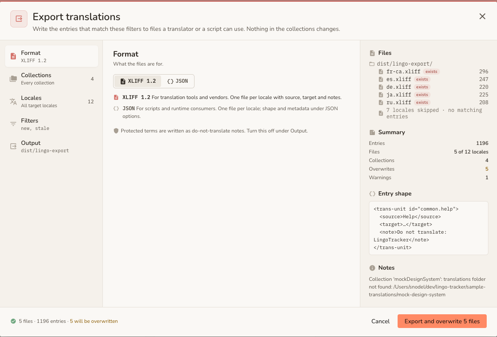

# Export Feature

Export writes translations to XLIFF 1.2 or JSON so you can hand them to a translation vendor, review them, or feed another system. By default it exports only what needs work: entries whose status is `new` or `stale`. The source files are never changed.

## Usage

```bash
lingo-tracker export --format <format> [options]
```

### Formats

- `xliff`: XLIFF 1.2 format (standard for translation tools).
- `json`: JSON format (flexible for developer workflows).

### Options

| Option | Description | Default |
|--------|-------------|---------|
| `-f, --format <format>` | Export format (`xliff` or `json`). | Required (or interactive) |
| `-c, --collection <names>` | Comma-separated list of collections to export. | All collections |
| `-l, --locale <locales>` | Comma-separated list of target locales. The base locale is always excluded. | All target locales of the exported collections |
| `-s, --status <statuses>` | Filter by status (`new`, `translated`, `stale`, `verified`). | `new,stale` |
| `-t, --tags <tags>` | Filter by tags (comma-separated). Matches against the resource's *effective tags* — the union of per-resource tags and the collection's inherited tags. | None |
| `-o, --output <path>` | Output directory. Defaults to `exportFolder` from config if set. | `dist/lingo-export` |
| `--filename <pattern>` | Custom filename pattern. The extension (`.xliff` or `.json`) is appended automatically if omitted. | `<locale>.xliff` or `<locale>.json` |
| `--no-protect-notes` | Leave protected-term annotations off exported entries. | Annotations on |
| `--dry-run` | Preview export without writing files or creating the output folder. | `false` |
| `--verbose` | Show detailed progress. | `false` |

### JSON Specific Options

| Option | Description | Default |
|--------|-------------|---------|
| `--structure <type>` | `hierarchical` or `flat`. | `hierarchical` |
| `--rich` | Output rich objects with metadata instead of plain string values. | `false` |
| `--include-base` | Include base locale value in the output object. | `false` |
| `--include-status` | Include translation status in the output object. | `false` |
| `--include-comment` | Include comments in the output object. | `false` |
| `--include-tags` | Include tags array in the output object. | `false` |
| `--base-property-name <name>` | Property name for the base locale value in JSON output. Only applies with `--include-base`. Reserved names (`value`, `comment`, `status`, `tags`) are rejected. | `baseValue` |

### Filename Placeholders

You can use the following placeholders in `--filename`. If no file extension is included, the correct extension for the format (`.xliff` or `.json`) is appended automatically.

- `{locale}` / `{target}`: The target locale code (e.g., `es`, `fr-ca`). These are interchangeable.
- `{source}`: The base locale code (e.g., `en`).
- `{date}`: Current date (YYYY-MM-DD).

**Example:**
```bash
lingo-tracker export --format json --filename "translations-{source}-to-{target}-{date}"
# Generates: translations-en-to-es-2025-12-13.json
```

### Target locales

A collection's target locales are its `locales` (or the global `locales` when it has none) without its base locale. The export writes one file per target locale of the exported collections, and each file holds only the resources of the collections that have that locale. The collections in one export must share a base locale, because an export file has one source language. To export collections with different base locales, run one export per collection with `--collection`.

## Examples

Export all untranslated and stale strings to XLIFF for all target locales:
```bash
lingo-tracker export --format xliff
```

Export only Spanish strings with `new` or `stale` status from a specific collection:
```bash
lingo-tracker export --format xliff --locale es --collection marketing --status new,stale
```

Export all target locales to flat JSON with a custom filename:
```bash
lingo-tracker export --format json --structure flat --filename "{locale}-translations"
# Generates: es-translations.json, fr-translations.json, etc.
```

Export JSON with comments (any `--include-*` flag implies `--rich`):
```bash
lingo-tracker export --format json --include-comment
```

Export rich JSON including base values and comments (useful for translator context):
```bash
lingo-tracker export --format json --include-base --include-comment
```

Export rich JSON with a custom property name for the base value (e.g. for tools that expect `original` instead of `baseValue`):
```bash
lingo-tracker export --format json --rich --include-base --base-property-name original
```

Preview an export without writing any files:
```bash
lingo-tracker export --format xliff --dry-run
```

## Customising the Base Value Property Name

Use `--base-property-name` to change the default `baseValue` field in rich JSON exports, for tools that expect another name such as `original`. The names `value`, `comment`, `status` and `tags` are reserved.

## Protected Term Annotations

Export marks the [protected terms](./protected-terms.md) it finds in each entry's source value. Translators and machine-translation services then know which words to leave unchanged.

In rich JSON, the terms appear under `doNotTranslate`:

```json
{
  "app.checkout.title": {
    "value": "Comprar con iPhone",
    "doNotTranslate": ["iPhone"]
  }
}
```

In XLIFF, they become a note on the trans-unit, after the comment note:

```xml
<note>Do not translate: iPhone</note>
```

When you import the translated file, LingoTracker ignores this note. The entry keeps its comment unchanged.

The terms that apply come from two files. LingoTracker combines the global protected-terms file with the exported collection's own file.

Matching is case-insensitive and matches whole words only. LingoTracker therefore marks `iPhone` in `Buy an IPHONE`, and leaves it unmarked in `iPhones`.

Base-locale rows stay unmarked, because a base-locale row holds nothing to translate. To turn off marking entirely, pass `--no-protect-notes`.

## XLIFF Source and Target Language

XLIFF 1.2 exports set `source-language` and `target-language` on the `<file>` element, which translation tools use to map locales. The import side reads `target-language` back to infer each file's locale:

```xml
<file original="translations" source-language="en" target-language="es" datatype="plaintext">
```

## Export Summary

Every export generates a timestamped `lingo-tracker-export-summary-<timestamp>.md` file in the **OS temp directory** (e.g. `/tmp` on macOS/Linux, `%TEMP%` on Windows) and prints the full path to the console. The file is written outside your project tree to avoid polluting your repository or breaking build pipelines that scan `.md` files. It contains:

- **Metadata**: date, format, collections, target locales, status and tag filters applied.
- **Results**: resources exported, files created, output directory.
- **File list**: each file generated (or that would be generated in a dry run).
- **Warnings**: e.g., files that were overwritten.
- **Errors**: broken down into general errors, malformed files, resources omitted due to missing metadata, and hierarchical key conflicts (JSON only — when a key like `a.b.c` conflicts with a parent key `a.b`).

Errors and hierarchical conflicts make the command exit 1. In a dry run the summary is printed to the console instead of written, and the exit code is always 0.

> **Note:** `--dry-run` does not create the output folder. It reports the files it would write and leaves the disk unchanged, even when the output directory does not exist yet.

## Interactive Mode

If you run `lingo-tracker export` without the `--format` flag **in a TTY terminal**, an interactive wizard guides you through all options. In non-interactive environments (CI, pipes), `--format` is required and omitting it is an error. All other unspecified options fall back silently to their documented defaults — pass all relevant flags explicitly in scripts rather than relying on interactive prompts.

## Export from the Tracker UI

The Tracker UI exports with the same options as the CLI. A live preview shows what the export will write before you run it.



### Open the dialog

- Select **Export…** in the head of the Collections section to export with all collections selected.
- Select **Export…** in the ⋮ menu of a collection card to export with only that collection selected.

Read-only collections can be exported.

### Settings

| Section | Controls | CLI flag |
|---------|----------|----------|
| Format | XLIFF or JSON. | `--format` |
| Collections | The collections to export. All collections must share one base locale. | `--collection` |
| Locales | The target locales. The base locale is never listed. | `--locale` |
| Filters | Resource statuses and tags. | `--status`, `--tags` |
| Output | Output folder and file name pattern. The pattern accepts the [placeholders](#filename-placeholders) above. | `--output`, `--filename` |
| JSON options | Structure (hierarchical or flat), rich objects, and the base value, status, comment and tags fields. JSON only. | `--structure`, `--rich`, `--include-*` |

### Preview and overwrite

The preview runs a dry run each time you change a setting. It lists the files and the number of resources in each file, and it shows the same warnings and errors as the CLI. Files that already exist in the output folder are marked as overwritten. The preview does not create the output folder or write any file.

Select **Export** to write the files. The files go to the output folder on the server, which is the `exportFolder` from your config, or `dist/lingo-export` when it is not set. The browser does not download them.

### Result strip

When the export finishes, a result strip appears on the Collections page:

- **Details** shows the files that were written, with any warnings and errors.
- **Dismiss** removes the strip.
- **Retry** runs the export again with the same settings. It appears when the export failed.

The export runs as a background job. The API behind it is described in the [API reference](../api.md).

### Remembered settings

The dialog remembers its settings for each project: format, filters, output folder, file name pattern and JSON options. The selection of collections and locales is not remembered, so each export starts from the collection you opened it from.
